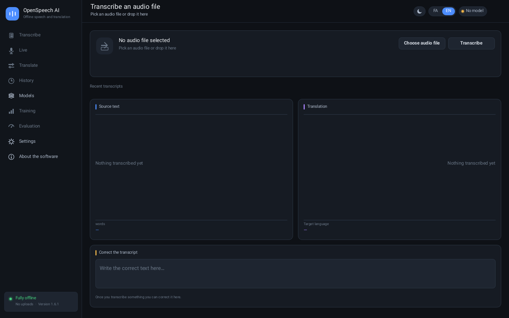

# OpenSpeech AI

**Offline multilingual speech recognition and translation for Windows — no bundled models.**

version 1.6.1 · Windows 10 1903+ / 11 x64 · GPL-3.0-or-later

خلاصهٔ فارسی: برنامه هیچ مدل ازپیش‌نصب‌شده‌ای همراه ندارد. در بخش «مدل‌ها» یک مدل
گفتار Whisper، یک مدل ترجمه Qwen GGUF و یک مدل تشخیص زبان (fastText یا GlotLID) را از منابع
رسمی دانلود و **فعال** می‌کنید. تا وقتی هر سه دسته مدل فعال نداشته باشند، رونویسی،
ترجمه و ترجمهٔ زنده غیرفعال می‌مانند. همهٔ داده‌ها در پوشهٔ `data` کنار فایل اجرایی
ذخیره می‌شوند و برنامه هیچ چیزی در AppData نمی‌سازد. رابط کاربری با زبان فارسی و
پوستهٔ روشن بالا می‌آید، درصد دانلود کنار دکمهٔ دانلود دیده می‌شود و نام مدل فعال
در بالای پنجره نوشته می‌شود.

```
dist/bin/OpenSpeechAI.exe          GUI executable, x86-64, static, worker embedded
dist/bin/OpenSpeechWorker.exe      isolated neural inference worker
dist/OpenSpeechAI-1.6.1-win64.zip  exe + worker + fonts/catalog/docs (no weights)
dist/checksums-1.6.1.txt           SHA-256 of exe, worker and zip
```


---

## What changed in 1.6.1

| Area | Behaviour |
|---|---|
| **The GPU switch told the truth, and now it can be trusted** | Reported with a screenshot: «پردازش روی گرافیک تنظیم شده اما در هنگام ترجمه سی‌پی‌یو کامل درگیره» — GPU selected, CPU pinned at 100%, no explanation. The shipped package is built with `-DGGML_USE_CPU` and contains no CUDA/Vulkan sources, so it registers exactly one device: the CPU. A new `OpenSpeechWorker --probe` asks llama.cpp's registry which devices exist and answers in milliseconds **without loading a model**; the app calls it once at startup. On a CPU-only package the GPU segment is now drawn inactive and cannot be selected, and the row says why in Persian rather than leaving the user to guess. A translation can never be reported as "on the GPU" when it is not. |
| **The device choice actually reaches the engine** | Even on a build that *can* offload, changing the setting did nothing: `ensure_worker()` reused the process that had been started with `--device cpu` until it exited. Changing the device (or the thread budget) now restarts the translation worker, so the next request really runs where the setting says. |
| **A slower-but-polite CPU** | Three sources of a permanently pinned processor, all fixed. The default thread budget only left a core free on machines with more than two cores, so a 2-core/4-thread i3-4160 used **every** core; it now always keeps one for the window, the OS and audio. The budget reached the recogniser but never the translator, so lowering it in Settings changed nothing during a translation. And llama.cpp's threadpool ships with `poll=50`, which spins ~6.5 M pause instructions per wait before sleeping — the worker now attaches a sleeping pool (`poll=0`) and threads cost microseconds of wake-up per token instead of burning a core between tokens. |

## What changed in 1.6.0

| Area | Behaviour |
|---|---|
| **آوانویسی for every language, not just English** | The line under the translation used to be produced for English only, and its vowels were placed by rule of thumb — often on ا/ی/و, which carries no short vowel in Persian. A new reader (`src/engines/pronounce.c`) works from the **script** instead of one language pair: Latin (with per-language rules for German, French, Spanish, Italian, Portuguese, Dutch, Turkish, Polish, Czech, Swedish, Finnish, Hungarian, Romanian, Vietnamese), Cyrillic, Greek, Arabic, Hebrew and Persian. Three rules are enforced by the emitter itself rather than by each table: a short vowel is a diacritic on the consonant *before* it (or gets a carrier at the start of a word), never on a long-vowel letter and never doubled; a long vowel is a letter. So `спасибо` → سپاسیبو, `καλημέρα` → کالیمِرا, `danke schön` → دَنکِ شُن, `dziękuję` → دزیکُیِ, `שלום` → شلوم. Accented letters are folded onto their base letter by a generated table (`tools/gen_pronounce_fold.py`), and a language's own rule still wins, so German `ü` stays یو while Polish `ś` is just ش. |
| **Translations no longer come back as a chat reply** | Reported: English → Persian, input «hello», output «Hello! How can I assist you today?». The worker asked for a translation by ISO code only (`"the language with ISO code fa"`), which a small quantised model does not reliably follow, and it answered the text instead of translating it. The prompt now names both languages in words (*from English into Persian*), forbids replying or greeting, and requires the output to be written in the target language's own script. The worker then **verifies** that with a script check shared with the UI (`src/engines/lang_script.c`): an answer in the wrong script is refused with an explanation and nothing is saved, instead of quietly showing an answer that is not a translation. A proper noun that legitimately comes back unchanged, a number, or a reply already written in the target script still passes. |
| **Honest limits instead of silence** | Chinese, Japanese, Korean, Thai and the Indic scripts cannot be read letter by letter without a dictionary. They are reported as unsupported and the Translate screen prints one sentence saying so, instead of an empty box that looks broken. |
| **CPU or GPU, with the truth reported** | Settings has a «پردازش روی» row (سی‌پی‌یو / گرافیک). The choice is stored in preferences and passed to the translation worker as `--device`; the worker asks llama.cpp whether it can offload and reports back which device it **actually** used. When the build has no GPU backend (the shipped build is CPU-only, `-DGGML_USE_CPU`), the row says so in Persian: the option exists, the app explains why it has no effect, and it never silently pretends. |

## What changed in 1.4.1

| Area | Behaviour |
|---|---|
| **Windows model path actually reaches the worker** | The field log showed the app verifying `C:\Users\Administrator\Desktop\New folder\data\Models\glotlid-small.bin`, while fastText received `C:UsersAdministratorDesktopNew folderdataModelsglotlid-small.bin`. The command-line builder counted backslashes before ordinary letters and then reset the counter **without writing them**. Quoting now follows the MSVCRT / `CommandLineToArgvW` rules exactly: literal backslashes are emitted, runs before a quote are doubled, and embedded quotes are escaped. The worker parses the wide command line itself and converts each argument to UTF-8, so spaces, Persian letters and backslashes survive the whole trip. |
| **Regression tests for the exact failure** | A portable quoting helper is tested against the reported Windows path, trailing backslashes, embedded quotes, empty arguments and Persian folders, with a reference MSVCRT parser checking the round trip. The real worker also loads a synthetic LID model from a path containing spaces, Persian and literal backslashes and answers a Persian `detect` request. A native Windows CI smoke job runs the shipped worker from a Persian/spaces folder. |
| **Readable activation failures** | The failure toast puts the explanation, the engine's own sentence and the log pointer on separate lines, so a long mixed Persian/English path is no longer hidden by the single-line fallback. |

## What changed in 1.4.0

| Area | Behaviour |
|---|---|
| **Language-model activation on non-ASCII paths** | fastText opened its model with a narrow `std::ifstream`, so a Persian (or any non-ASCII) folder name failed *inside the worker* after the app had already verified the file. On Windows the worker now opens the file itself with the wide API (`_wfopen`) and streams it to fastText, so the path never passes through the ANSI code page. |
| **Self-healing model paths** | If the recorded path of an installed model is gone (folder moved, backup restored, profile migrated), activation searches the models folder, `data\Models` and the downloads folder for the same catalogue file, verifies size + SHA-256, repairs the database row and continues. |
| **Precise activation errors** | "file could not be opened" used to cover five different causes. Activation now distinguishes: unknown id, category mismatch, **missing file (with the expected path and a Sync hint)**, wrong size (actual vs expected bytes) and failed SHA-256 — and the failure toast wraps to up to four lines so the reason and path stay readable. |
| **RAM per model + light badges** | Every catalogue row states the approximate memory the model needs while running («رم لازم»), and models that fit in about 1 GB carry a «سبک» (light) badge. The activation memory check uses the same per-model figure. |
| **Lighter models** | Whisper Tiny Q5_1 (31 MB), Base Q5_1 (57 MB) and Small Q5_1 (181 MB) for speech; Qwen2.5 0.5B Q4/Q8 (469/644 MB) for translation — usable on 2–4 GB machines. |
| **Six language-identification models** | fastText LID 176 full/.ftz plus **GlotLID v4**: small .ftz (34 MB), small full (125 MB), full .ftz (97 MB) and full (747 MB), covering 2000+ language varieties. GlotLID's `pes_Arab`-style labels are normalised to the two-letter codes Whisper and the translator use (fa, en, ar, zh, …), in both detection results and the ready language list. |
| **Pinned catalogue tooling** | `tools/catalog/generate.py` regenerates `catalog.json` from the compiled-in table (now including `min_ram_mb`), and `check.py` validates the RAM figures against the source. New upstream URLs are pinned to immutable revisions. |

## What changed in 1.3.0

| Area | Behaviour |
|---|---|
| **Portable data folder** | Everything is created under `<exe folder>\data\` — models, downloads, database, logs, audio, cache and `settings.ini`. Nothing is written to AppData. An existing `%LOCALAPPDATA%\OpenSpeechAI` profile is moved into `data\` once, then removed if empty. |
| **Activation actually works** | `OpenSpeechWorker.exe` is embedded in `OpenSpeechAI.exe` as a resource and extracted (SHA-256 checked) to `data\Cache` on first use. The child is started with an explicit application path and working directory, inheritable pipes are set up correctly, and its stderr goes to `data\Logs\worker.log`. Failures report the real Windows error code instead of a generic "keep the worker beside the exe". |
| **Active model in the header** | The window header names the active speech, translation and language model on every screen; activating a model shows a confirmation naming it, plus a "loading/activating" state while the engines load. |
| **Download percentage** | Each downloading row shows a progress bar, the percentage next to it (bytes received when the server sends no length) and a **Cancel** button; the header chip mirrors the percentage. |
| **No local-file import** | The "add model from file" button and its file dialog were removed. Models install only from the pinned official catalogue. |
| **Bigger catalogue** | 5 Whisper variants, 5 Qwen2.5 translation quants and 2 fastText LID models (including the 0.9 MB `.ftz`), each pinned by exact size and SHA-256. |
| **Persian + light by default** | A fresh install opens in Persian with the light theme; both remain switchable in the chrome and Settings. |
| **About** | Renamed to «درباره نرم‌افزار» with the header «تشخیص گفتار و ترجمه آفلاین», plus a developer card (behnam ehsani, inbox.ehsani@gmail.com, project repository) whose email/repository links open on click. |

## What changed in 1.2.0

| Area | Behaviour |
|---|---|
| **Crash on audio selection** | Selecting a file only loads/decodes audio on a background job. The Windows M4A/AAC path was rewritten around `MFCreateSourceReaderFromURL` with balanced COM/MF lifetime and MTA; it no longer installs a custom `IStream` vtable. |
| **No bundled models** | Fresh install has zero installed/active models. The old exemplar/phrasebook containers and tiny/base Whisper entries are not shipped or auto-installed. |
| **Verified downloads** | Catalog entries are pinned by exact byte size and SHA-256. Downloads run off the UI thread, support resume/cancel, and install **inactive**. Activation is a separate explicit action. |
| **One active model per category** | Speech (`asr`), translation (`mt`) and language ID (`lang`) each have at most one active row, enforced by a SQLite partial unique index and an activation transaction. |
| **Gating** | Transcribe, translate and live require active ASR + MT + LID. File selection is also gated. The sidebar/chrome show what is missing. |
| **Model-derived languages** | Whisper language choices come from the loaded model. Translation targets come from the active translation model's capability list; auto-detect uses the active fastText LID model. |
| **Live translation** | Microphone partials use the same active models through a no-history API. Stop closes the mic and reaps the worker; shutdown joins safely. |
| **Honest training/evaluation** | Fine-tuning quantized inference artifacts is unsupported and says so. Evaluation reports zero samples / no labelled data instead of synthetic WER/CER. |
| **Long text / Unicode** | 64 KiB text buffers, strict UTF-8/surrogate JSON decoding, chunked MT with overflow/incomplete-output failure, history stores full translation/duration. |

## Downloadable models

| Category | Model | Download | RAM needed | Licence |
|---|---|---:|---:|---|
| Speech | Whisper Tiny Q5_1 | 30.7 MiB | 500 MiB | MIT |
| Speech | Whisper Base Q5_1 | 56.9 MiB | 600 MiB | MIT |
| Speech | Whisper Small Q5_1 | 181.3 MiB | 1.0 GiB | MIT |
| Speech | Whisper Medium Q5_0 | 514.2 MiB | 1.5 GiB | MIT |
| Speech | Whisper Large v3 Turbo Q5_0 | 547.4 MiB | 1.6 GiB | MIT |
| Speech | Whisper Medium Q8_0 | 785.2 MiB | 2.0 GiB | MIT |
| Speech | Whisper Large v3 Turbo Q8_0 | 833.7 MiB | 2.1 GiB | MIT |
| Speech | Whisper Large v3 Q5_0 | 1.01 GiB | 2.9 GiB | MIT |
| Translation | Qwen2.5 0.5B Instruct Q4_K_M | 468.6 MiB | 1.0 GiB | Apache-2.0 |
| Translation | Qwen2.5 0.5B Instruct Q8_0 | 644.4 MiB | 1.2 GiB | Apache-2.0 |
| Translation | Qwen2.5 1.5B Instruct Q4_K_M | 1.04 GiB | 1.8 GiB | Apache-2.0 |
| Translation | Qwen2.5 3B Instruct Q4_K_M | 1.96 GiB | 2.7 GiB | Apache-2.0 |
| Translation | Qwen2.5 3B Instruct Q6_K | 2.60 GiB | 3.4 GiB | Apache-2.0 |
| Translation | Qwen2.5 3B Instruct Q8_0 | 3.37 GiB | 4.2 GiB | Apache-2.0 |
| Translation | Qwen2.5 7B Instruct Q3_K_M | 3.55 GiB | 4.7 GiB | Apache-2.0 |
| Language ID | fastText LID 176 (compressed) | 0.9 MiB | 300 MiB | CC-BY-SA-3.0 |
| Language ID | fastText LID 176 (full) | 125.2 MiB | 1.4 GiB | CC-BY-SA-3.0 |
| Language ID | GlotLID v4 small (compressed) | 33.7 MiB | 400 MiB | Apache-2.0+notices |
| Language ID | GlotLID v4 small (full) | 124.9 MiB | 900 MiB | Apache-2.0+notices |
| Language ID | GlotLID v4 (compressed) | 96.5 MiB | 700 MiB | Apache-2.0+notices |
| Language ID | GlotLID v4 (full) | 746.5 MiB | 2.9 GiB | Apache-2.0+notices |

RAM figures are approximate resident-memory estimates for choosing a model; the UI shows the same number and marks light models with «سبک».
Exact pinned URLs/hashes live in `src/app/osai_app.c` and `tools/catalog/catalog.json`.
Nothing is downloaded automatically. Inference is offline after installation.
Pick the smaller quants on a 8 GB machine; the 7B row needs ~6 GB of free RAM.

## Running

Requirements: Windows 10 version 1903 or newer / Windows 11, 64-bit. 8 GB RAM
minimum recommended for Qwen2.5 3B; several GB free disk for chosen models.
Internet is needed only when you press Download.

Extract the zip into a **writable** folder (e.g. `C:\OpenSpeechAI` or your
Desktop) and run:

```
OpenSpeechAI.exe
```

The worker is embedded in the exe and extracted to `data\Cache` when needed, so
the executable also works on its own. Keep `assets/fonts` and `assets/catalog.json`
beside it for the bundled font/catalog fallbacks. All state lives next to the exe:

```
data\Models\        downloaded, hash-verified models
data\Downloads\     partial downloads (resumable)
data\Audio\         copies of transcribed files
data\Database\      SQLite transcripts/translations/model cards
data\Logs\          fault/timing logs and worker.log (no speech text by default)
data\Cache\         extracted inference worker
data\Logs\worker.log  why a model load failed (app notes + worker stderr)
data\settings.ini   language, theme, threads, last languages
```

First run: open **Models**, download one ASR + one MT + one LID model, then
activate each. If you already have model files, set the folder in **Settings →
Models folder** and press **Sync**: recognised files appear under *Installed*.
Deleting a model from that list removes both the file and its database row. The app remains gated until all three are active, and the header
shows which model is active in each category.

If the folder is read-only (e.g. `C:\Program Files` without elevation) the app
says so at startup instead of failing later; move it somewhere writable.

## Screenshots

| | |
|---|---|
|  |  |
|  |  |

Images are rendered by the application's own drawing code from a fresh empty
install (`make snapshots`, Persian + light by default). They show disabled/gated
states, not fake transcripts.

## Building

```
make bootstrap      # fetch zig cross toolchain
make linux -j2      # headless host + worker
make tests          # regression suite + fresh-install selftest
make snapshots      # regenerate dist/screenshots (add --dark for the dark set)
make win -j2        # cross-build worker, then the exe with the worker embedded
make dist           # catalog check, package zip, verify PE headers
```

Optional real-model smoke test (user-supplied official artifacts):

```
OSAI_TEST_ASR=/path/ggml-medium-q5_0.bin \
OSAI_TEST_MT=/path/qwen2.5-3b-instruct-q4_k_m.gguf \
OSAI_TEST_LID=/path/lid.176.bin \
OSAI_TEST_WAV=/path/speech.wav \
make tests
```

Without those variables the suite validates gating/catalog/store/Unicode/audio/
worker isolation, the portable `data/` layout and the one-time profile migration,
and explicitly skips real inference. `OSAI_DATA_DIR` overrides the data root for
tests only; the shipped app always uses `<exe folder>\data`.

## Validation status

- Linux: `make tests` (306 checks, including the exact Windows argv quoting
  regression, a real worker handshake, `detect` round trips against a synthetic
  fastText fixture, a load from a spaces/Persian/backslash path, and
  pronunciation for eighteen languages, and the "answered instead of translated"
  case) and `make snapshots` pass in this
  environment.
- Windows: cross-build succeeds; `tools/verify_exe.py` checks PE subsystem,
  manifests, the embedded worker payload and load-bearing strings.
- **Not performed here:** native Windows microphone/Media Foundation runtime and
  real-weight download/inference end-to-end. The Windows build is compiled and
  statically checked here; a native Windows CI smoke job exercises the shipped
  worker from a Persian/spaces folder. Confirming activation with the downloaded
  GlotLID weights on the user's machine still needs that machine.

## Architecture

```
ui/          drawn canvas, HarfBuzz/FreeType text, immediate-mode widgets
app/         local API: gating, model lifecycle, history, downloads
worker/      isolated llama.cpp MT + fastText LID process (JSON lines)
engines/     whisper.cpp bridge (ASR), legacy helpers retained but not bundled
core/        SQLite store, audio decoders, SHA-256, HTTP, process wrapper, paths
platform/    Win32 host, Media Foundation URL reader, microphone
```

See `docs/ARCHITECTURE.md` and `docs/MODEL_FORMAT.md`.

## Developer

behnam ehsani · inbox.ehsani@gmail.com ·
<https://github.com/wrappedman/AI-voice-Translator>

## Licence

Application: GPL-3.0-or-later. Fonts: Vazirmatn (SIL OFL 1.1). Vendored engine
sources: llama.cpp (MIT), fastText (MIT), nlohmann/json (MIT). Downloaded model
weights carry their own licences, shown in the Models screen and catalog.
