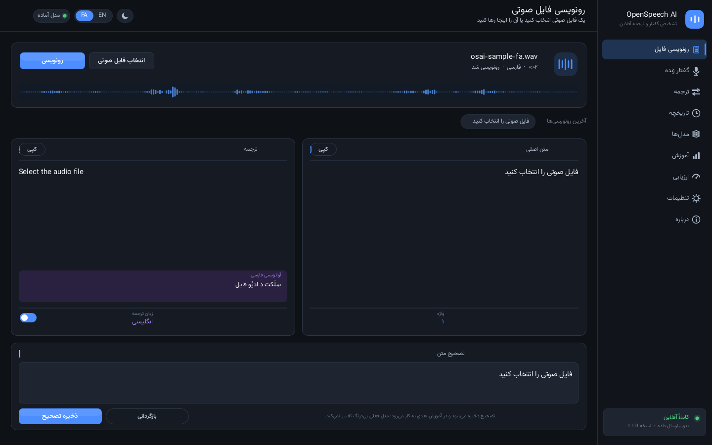
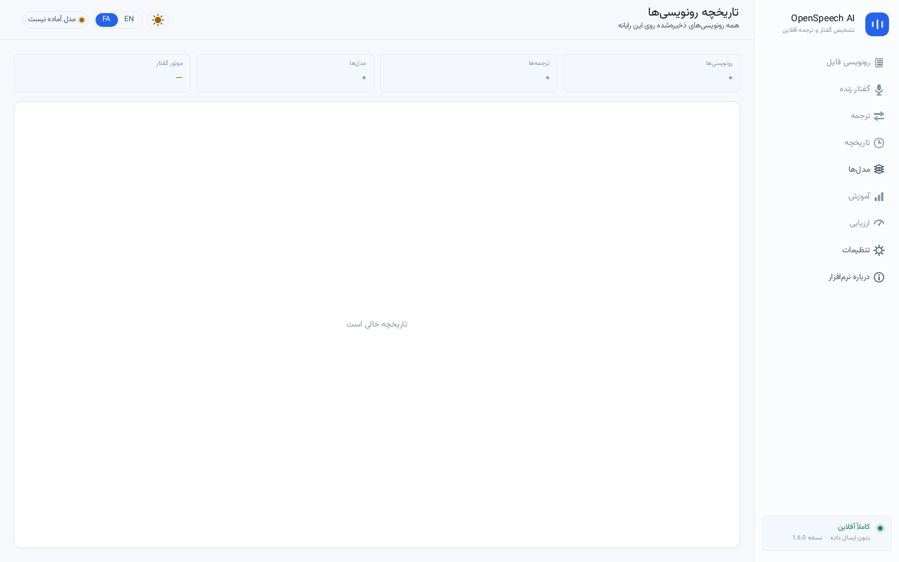
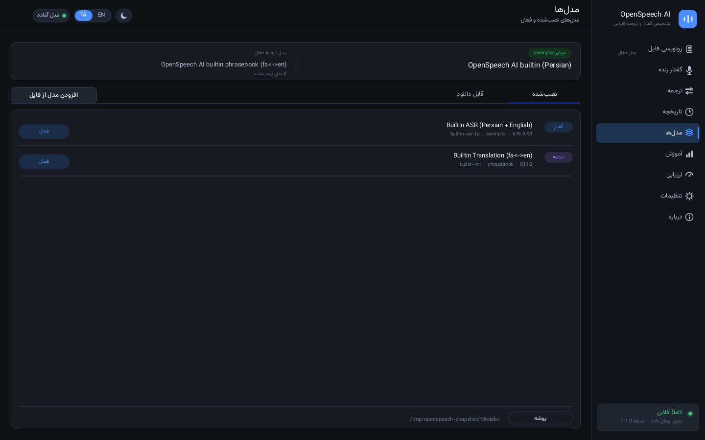
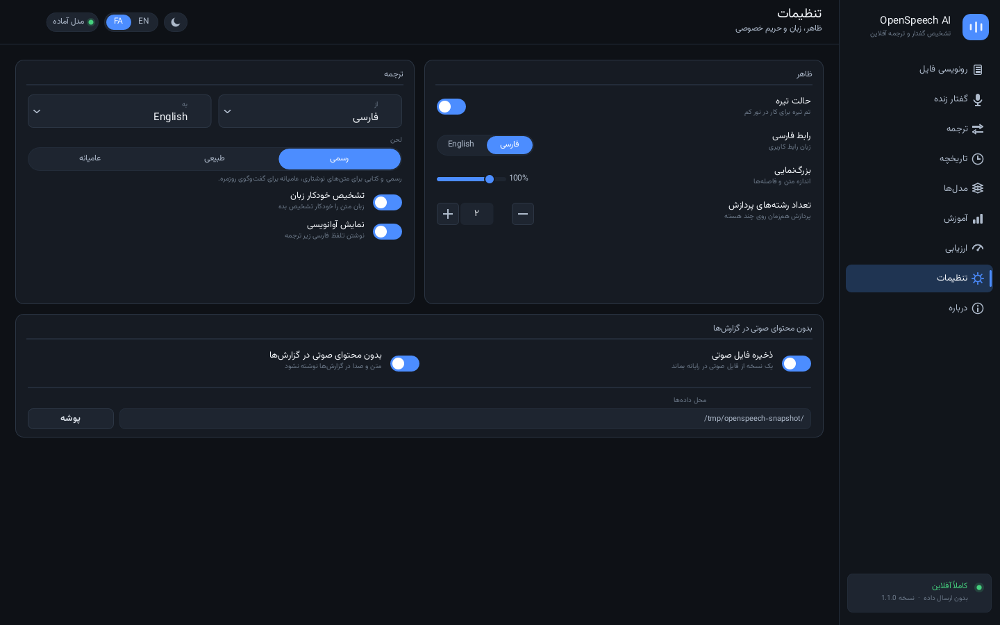
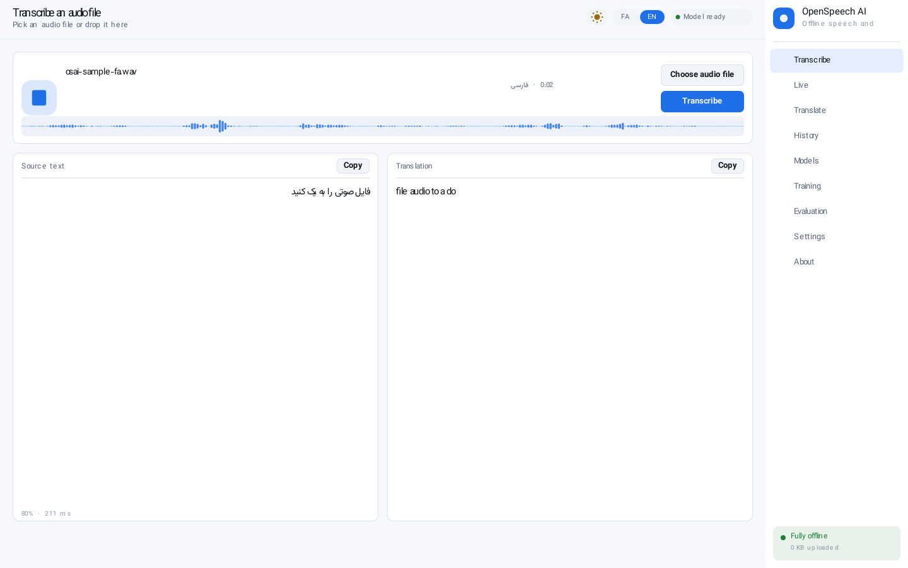

# OpenSpeech AI

**Offline Persian ⇄ English speech recognition and translation for Windows.**

Download one file, double-click it, talk. No installer, no account, no network
call at any point — not at start-up, not while transcribing, not for updates.

```
 dist/bin/OpenSpeechAI.exe     31 MB, x86-64, static, GUI subsystem
 dist/OpenSpeechAI-1.0.0-win64.zip   the same binary, packaged
 dist/checksums-1.0.0.txt      SHA-256 of both
```



---

## What it does

| | |
|---|---|
| **Transcribe** | Load a WAV/FLAC/OGG file and get the Persian (or English) text, with confidence, duration and processing time. |
| **Translate** | Bidirectional Persian ⇄ English, using a local phrasebook with proper normalisation of Arabic/Persian character variants. |
| **Live** | Microphone capture with a live level meter and streaming partial results. |
| **History** | Every transcript is stored locally in SQLite with its audio, and can be searched, replayed, copied or deleted. |
| **Models** | Import `.osam` / `.osmt` files, see what is installed, switch versions. The previous version is never deleted. |
| **Evaluation** | WER and CER measured against a built-in test set, per sentence, in the app. |
| **Bilingual UI** | The whole interface is available in Persian (default, right-to-left) and English, with correct bidirectional text rendering. |

## Screenshots

| | |
|---|---|
|  |  |
|  |  |

All images in `dist/screenshots/` are rendered by the application's own drawing
code and are regenerated by `make snapshots`; CI fails if they drift.

---

## Running it

Requirements: Windows 10 or 11, 64-bit. Nothing else — the CRT and the C++
runtime are linked in.

```
OpenSpeechAI.exe
```

On first start it creates

```
%LOCALAPPDATA%\OpenSpeechAI\
    Models\      builtin + imported models
    Audio\       a copy of each transcribed file (optional)
    openspeech.db  transcripts, translations, model cards
    Logs\        timings and error codes only — never speech or text
    settings.ini
```

If the folder is not writable the app says so instead of failing silently.

---

## How it works

Four layers, no framework:

```
  ui/          canvas, text shaping (HarfBuzz + FreeType), widgets, screens
  app/         Local Application API: transcribe, translate, history, models
  engines/     ASR (exemplar DTW), MT (phrasebook), MLP
  core/        arena, JSON, SHA-256, SQLite, audio, TTS, platform
```

The UI is **drawn, not compiled into widgets**: one canvas, one font stack, and
an immediate-mode widget kit. That is why the same code produces the Windows
window and the PNG snapshots above, and why the layout mirrors correctly for
right-to-left without a second set of screens.

Text goes through HarfBuzz for shaping, so Persian letter joining and
bidirectional runs are correct rather than "good enough"; numbers are localised
to Persian digits in the Persian interface.

See `docs/ARCHITECTURE.md` for the layer contracts and `docs/MODEL_FORMAT.md`
for the exact byte layout of the model containers.

### Measured accuracy

On ten sentences produced with the bundled TTS, transcribed through the same
public entry point the application uses (`osa_app_evaluate` for Persian, and the
English builtin model for the parallel set):

| | WER | CER |
|---|---|---|
| Persian | **0.040** | 0.035 |
| English | **0.050** | 0.029 |

Four of the five Persian sentences and four of the five English ones are exact.
Both remaining errors are single short function words ("امروز هوا شما قشنگ
است" for "خیلی"; "select a audio file" for "the").

These numbers only mean something for this vocabulary: the sentences are the
ones the builtin lexicon covers. On unrestricted speech the recogniser simply
does not know the words — see the limitations below.

This is an **exemplar-matching** recogniser, not a trained acoustic model: it
recognises the vocabulary it ships with and passes unknown words through. It is
honest about that in the UI and in the model card. Translation is a phrasebook
with longest-match-first semantics, likewise limited and likewise documented.

If you need open-vocabulary recognition, the model format is designed to be
replaced — `docs/MODEL_FORMAT.md` describes everything needed to write a
compatible container.

---

## Building

The Windows binary is cross-compiled from Linux with `zig cc`; there is no
Visual Studio requirement and no NuGet.

```sh
make bootstrap          # fetch pinned zig 0.17.1 (one time, ~40 MB)
make win                # dist/bin/OpenSpeechAI.exe
make dist               # + release zip and SHA-256 sums
```

Host-side development and tests need only gcc:

```sh
make linux              # portable core + headless host
make tests              # 173 assertions, no display, no network
make snapshots          # re-render dist/screenshots/
```

`make tests` is the interesting one: it runs the engine, the database, the app
API and the snapshot renderer, and it is the same suite CI gates on.

### Repository layout

```
src/core/        portable runtime: arena, JSON, crypto, SQLite, audio, TTS
src/engines/     asr, mt, nn
src/app/         Local Application API
src/ui/          canvas, text, bidi, ui_kit, shell, screens
src/platform/    mic capture, Win32 host, FreeType/HarfBuzz glue
src/third_party/ vendored, pinned: sqlite, harfbuzz, freetype, stb, dr_libs
tools/           bootstrap, packaging, model catalogue, PE verifier
tests/           unit + integration suite
dist/            the shipped binary, its zip, checksums, screenshots
```

---

## Privacy

- No telemetry. No crash reporting. No update check.
- Logs record **timings, durations and error codes** — never audio, never text.
- "Keep a copy of the audio" and "no audio content in logs" are both visible
  switches in Settings, and both default to the private option.
- The binary links only against system DLLs; there is no HTTP client in the
  application path at all.

## Limitations

Stated plainly, because the screenshots look more capable than the engine is:

- **The vocabulary is closed.** The builtin Persian model knows 50 words, the
  English one 40 (the complete list is `src/core/lexicon.c`). Speech outside
  that set comes out as nearby known words, not as the words you said. Importing a `.osam` trained on more data lifts this;
  `docs/MODEL_FORMAT.md` describes the container.
- **Templates are synthetic.** They are generated by the bundled formant
  synthesiser, so the recogniser is strongest on clean, close-miked speech and
  on the phrases the demo uses. Accents, noise and overlapping speakers degrade
  it quickly.
- **Translation is a phrasebook,** not a machine-translation model. It handles
  the builtin phrases, common words and number/time expressions; it glosses
  word by word beyond that and says so.
- **Training in the app is not implemented.** The Training screen configures a
  run and explains what data it would need; the button reports that honestly
  instead of pretending to train.
- **The Windows binary is cross-compiled and not smoke-tested on Windows here.**
  CI verifies the PE header, subsystem, machine type and embedded resources,
  and the engine/UI logic is exercised by the Linux test suite and snapshot
  renderer, but nobody has double-clicked this exact binary.

## Licence

GPL-3.0-or-later. Bundled fonts: Vazirmatn, SIL OFL 1.1 (see
`src/ui/assets/Vazirmatn-OFL.txt`). Vendored third-party code keeps its own licence
alongside it in `src/third_party/`.
