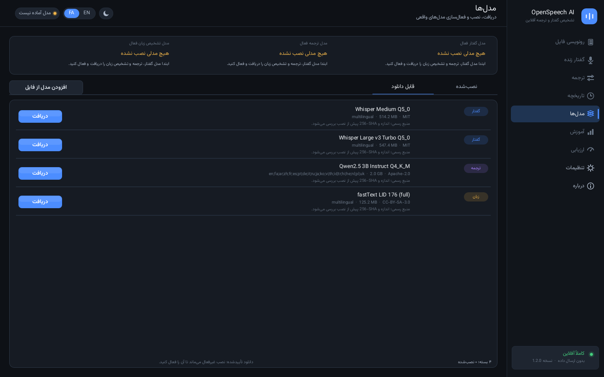

# OpenSpeech AI

**Offline multilingual speech recognition and translation for Windows — no bundled models.**

version 1.2.0 · Windows 10 1903+ / 11 x64 · GPL-3.0-or-later

خلاصهٔ فارسی: برنامه دیگر هیچ مدل کوچک یا ازپیش‌نصب‌شده همراه ندارد. در بخش «مدل‌ها»
یک مدل گفتار Whisper، یک مدل ترجمه Qwen GGUF و مدل تشخیص زبان fastText را دانلود و
**فعال** می‌کنید. تا وقتی هر سه دسته مدل فعال نداشته باشند، رونویسی، ترجمه و ترجمهٔ
زنده غیرفعال می‌مانند. زبان‌های قابل انتخاب از خود مدل فعال خوانده می‌شوند، نه یک
فهرست ثابت فارسی/انگلیسی. آموزش درون‌برنامه‌ای برای این مدل‌های کوانتیزه پشتیبانی
نمی‌شود و ارزیابی بدون دادهٔ برچسب‌خورده عدد ساختگی نشان نمی‌دهد.

```
dist/bin/OpenSpeechAI.exe          GUI executable, x86-64, static
dist/bin/OpenSpeechWorker.exe      isolated neural inference worker
dist/OpenSpeechAI-1.2.0-win64.zip  exe + worker + fonts/catalog/docs (no weights)
dist/checksums-1.2.0.txt           SHA-256 of exe, worker and zip
```


---

## What changed in 1.2.0

| Area | Behaviour |
|---|---|
| **Crash on audio selection** | Selecting a file only loads/decodes audio on a background job. The Windows M4A/AAC path was rewritten around `MFCreateSourceReaderFromURL` with balanced COM/MF lifetime and MTA; it no longer installs a custom `IStream` vtable. |
| **No bundled models** | Fresh install has zero installed/active models. The old exemplar/phrasebook containers and tiny/base Whisper entries are not shipped or auto-installed. |
| **Verified downloads** | Catalog entries are pinned by exact byte size and SHA-256. Downloads run off the UI thread, support resume/cancel, and install **inactive**. Activation is a separate explicit action. |
| **One active model per category** | Speech (`asr`), translation (`mt`) and language ID (`lang`) each have at most one active row, enforced by a SQLite partial unique index and an activation transaction. The Models/About screens label the active model in each category. |
| **Gating** | Transcribe, translate and live require active ASR + MT + LID. File selection/import are also gated. The sidebar/chrome show what is missing. |
| **Model-derived languages** | Whisper language choices come from the loaded model. Translation targets are the supported Qwen2.5 language set; auto-detect uses the active fastText LID model. |
| **Live translation** | Microphone partials use the same active models through a no-history API. Stop closes the mic and reaps the worker; shutdown joins safely. |
| **Honest training/evaluation** | Fine-tuning quantized inference artifacts is unsupported and says so. Evaluation reports zero samples / no labelled data instead of synthetic WER/CER. |
| **Long text / Unicode** | 64 KiB text buffers, strict UTF-8/surrogate JSON decoding, chunked MT with overflow/incomplete-output failure, history stores full translation/duration. |

## Downloadable models

| Category | Model | Size | Licence |
|---|---|---:|---|
| Speech | Whisper Medium Q5_0 (`ggml-medium-q5_0.bin`) | 539 MB | MIT |
| Speech | Whisper Large v3 Turbo Q5_0 (`ggml-large-v3-turbo-q5_0.bin`) | 574 MB | MIT |
| Translation | Qwen2.5 3B Instruct Q4_K_M (`.gguf`) | 2.10 GB | Apache-2.0 |
| Language ID | fastText LID 176 full (`.bin`, not `.ftz`) | 131 MB | CC-BY-SA-3.0 |

Exact pinned URLs/hashes live in `src/app/osai_app.c` and `tools/catalog/catalog.json`.
Nothing is downloaded automatically. Inference is offline after installation.

## Running

Requirements: Windows 10 version 1903 or newer / Windows 11, 64-bit. 8 GB RAM
minimum recommended for Qwen2.5 3B; several GB free disk for chosen models.
Internet is needed only when you press Download.

```
OpenSpeechAI.exe
```

Keep `OpenSpeechWorker.exe` next to `OpenSpeechAI.exe`, plus `assets/fonts` and
`assets/catalog.json`. Data is created under `%LOCALAPPDATA%\OpenSpeechAI`:

```
Models\        downloaded/imported verified models
Audio\         copies of transcribed files
Database\      SQLite transcripts/translations/model cards
Logs\          fault/timing logs (no speech text by default)
settings.ini
```

First run: open **Models**, download one ASR + one MT + the LID model, then
activate each. The app remains gated until all three are active.

## Screenshots

| | |
|---|---|
|  |  |
|  |  |

Images are rendered by the application's own drawing code from a fresh empty
install (`make snapshots`). They show disabled/gated states, not fake transcripts.

## Building

```
make bootstrap      # fetch zig cross toolchain
make linux -j2      # headless host + worker
make tests          # regression suite + fresh-install selftest
make snapshots      # regenerate dist/screenshots
make win -j2        # cross-build OpenSpeechAI.exe + OpenSpeechWorker.exe
make dist           # catalog check, package zip, verify PE headers
```

Optional real-model smoke test (user-supplied official artifacts):

```
OSAI_TEST_ASR=/path/ggml-medium-q5_0.bin \
OSAI_TEST_MT=/path/qwen2.5-3b-instruct-q4_k_m.gguf \
OSAI_TEST_LID=/path/lid.176.bin \
OSAI_TEST_WAV=/path/speech.wav \
make tests
```

Without those variables the suite validates gating/catalog/store/Unicode/audio/
worker isolation and explicitly skips real inference.

## Validation status

- Linux: `make tests` and `make snapshots` pass in this environment.
- Windows: cross-build succeeds; `tools/verify_exe.py` checks PE subsystem,
  manifests and load-bearing strings for both executables.
- **Not performed here:** native Windows microphone/Media Foundation runtime,
  real-weight download/inference end-to-end. The MF crash fix is compiled and
  statically checked, but needs a Windows machine with the chosen models to
  confirm the original `mfreadwrite.dll` access violation is gone.

## Architecture

```
ui/          drawn canvas, HarfBuzz/FreeType text, immediate-mode widgets
app/         local API: gating, model lifecycle, history, downloads
worker/      isolated llama.cpp MT + fastText LID process (JSON lines)
engines/     whisper.cpp bridge (ASR), legacy helpers retained but not bundled
core/        SQLite store, audio decoders, SHA-256, HTTP, process wrapper
platform/    Win32 host, Media Foundation URL reader, microphone
```

See `docs/ARCHITECTURE.md` and `docs/MODEL_FORMAT.md`.

## Licence

Application: GPL-3.0-or-later. Fonts: Vazirmatn (SIL OFL 1.1). Vendored engine
sources: llama.cpp (MIT), fastText (MIT), nlohmann/json (MIT). Downloaded model
weights carry their own licences, shown in the Models screen and catalog.
